## **SEMINARIO 1 - DDSI | GRUPO: CEUTAFEET**

Para está práctica hemos decidido hacer una página web, a preferencia de nuestro integrante `David`.

La práctica se podría haber enfocado al funcionamiento en terminal, e incluso así podriamos haber controlado y mostrado mejor el funcionamiento interno del programa, pero se hará una explicacion a fondo de este y una noción básica del frontend.

La web hemos decidido hacerla con HTML, CSS, y JAVASCRIPT para el frontend, y PHP con consultas desde Javascript (AJAX) para el backend. \

En resumen, primero tenemos la estructura de la web en HTML y CSS para el diseño, le añadimos Javascript para hacerla dinámica ( añadir desplegables o formularios que aparecen dinámicamente con los botones, o cambiar entre tablas ), pero hay ciertos botones que tienen funcionalidades internas, aqui entramos en consultas AJAX, ya sea para traernos información del Servidor o enviarla, esta llega al código PHP, hace sus respectivas consultas a la BBDD y, en tiempo real Javascript hace esos cambios en la web, de está forma no tenemos que estar refrescando la página todo el rato.

Con esto ya podemos empezar con todas las explicaciones y documentación.


### **HTML / CSS / JAVASCRIPT  ( FRONTEND )**

Antes empezar a explicar toda la parte del servidor, vamos a hacer una breve explicación, no entraremos en detalle con el código, ya que no es el objetivo de la práctica.

Normalmente el codigo Javascript y el CSS se puede organizar en distintos archivos, pero como no es el caso de una página web que vayamos a extender más lo hemos dejado todo en sus archivos principales ( aunque estén algo desordenados y caóticos ).

- 1. Primero hemos creado una estructura básica en HTML, con las etiquetas básicas, un header para la barra superior, y dentro del main ya metemos el section con sus div's correspondientes y la tabla, que irá cambiando dinámicamente dependiendo de la elegida.

- 2. Lo siguiente es añadirle el estilo con CSS, el cuál funciona seleccionando por clases/ids o incluso por la propia etiqueta de HTML y funciona en cascada. CSS tiene una infinidad de opciones para añadir a las etiquetas, hemos añadido colores, distribución de los contenedores, paddings, borders etc.

- 3. Finalmente tenemos el código Javascript que tiene varias funciones, una de ellas es la creación de codigo HTML en tiempo real para el dinamismo, por ejemplo cuando cambiamos de tabla o queremos modificar o añadir datos, todo esto más de cara al cliente. De cara al servidor se encarga de consultas con los distintos archivos PHP mediante AJAX ( básicamente peticiones fetch ), ya sea para traernos información al cliente, como para enviar la información de los formularios y PHP interactue con la base de datos.

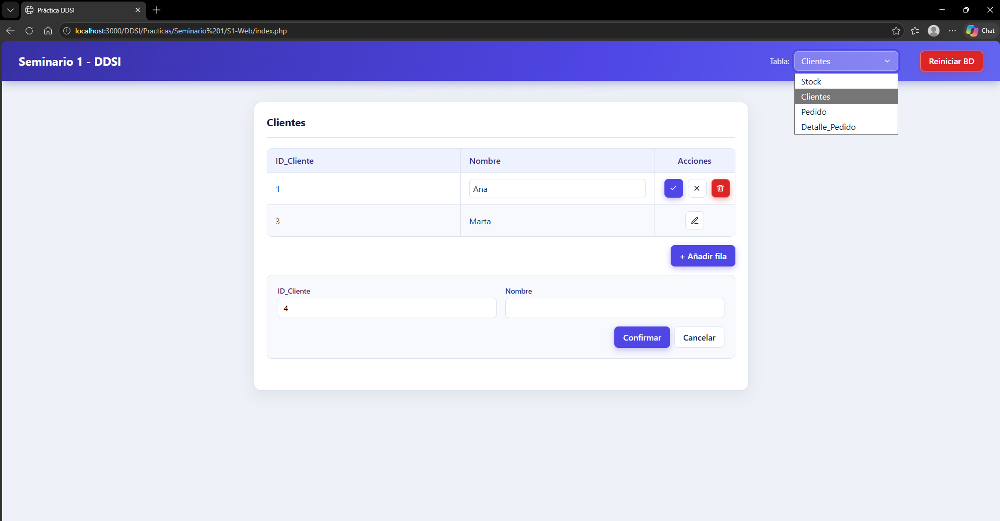


### SETUP PHP Y ORACLE

Ahora vamos a explicar el proceso de preparación, para programar, conexión con la BD y todo lo relacionado.

Lo primero de todo hemos descargado XAMPP, que viene con todo incluido, PHP, SQL, Apache, etc. También tenemos la opción de añadir extensiones como PHP Server, pero aún así necesitamos tener PHP instalado. Tras descargarlo todo, añadimos nuestra ruta de PHP ( C:/xampp/php/ ) a nuestras variables de entorno y ya podríamos empezar. ( Puede que necesitamos configurar el IDE con ciertas rutas, pero depende de este. )

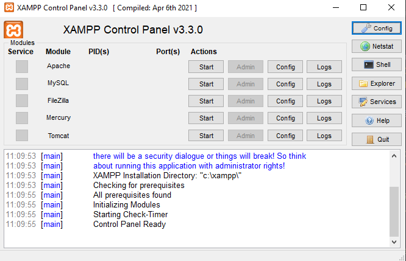

Después necesitamos Oracle SQL Developer o por su defecto alguna de las extensiones que pueda sustituirla en nuestro IDE, para conectarnos con la Base de Datos de la UGR.

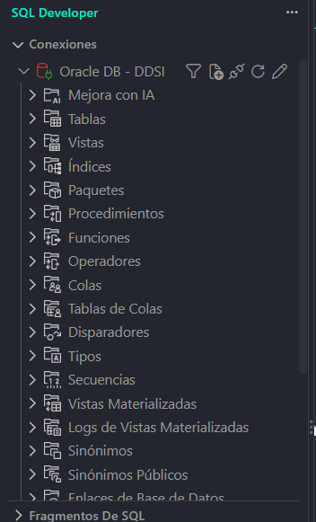

Finalmente para conectar nuestro lenguaje con la Base de datos de Oracle necesitaremos ( dependiendo del sistema ) otras herramientas, en nuestro caso con PHP necesitamos Oracle Instant Client, junto con el ODBC Package ( También hemos añadido SQLPlus, que nos ayuda a conectarnos por terminal ), puede que también necesitemos añadir la ruta al PATH de variables de entorno.

Finalmente configuramos el ODBC entrando con Windows + R en `odbcad32` para poder conectarnos mediante php y ya tendriamos todo listo.

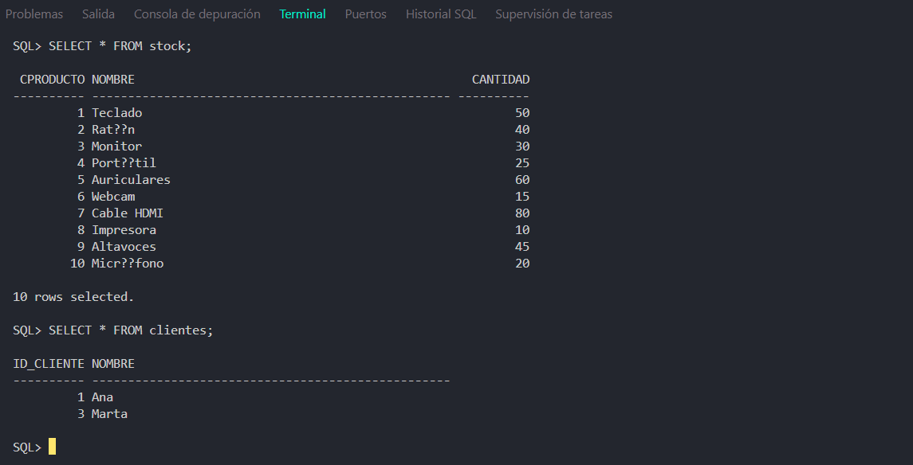

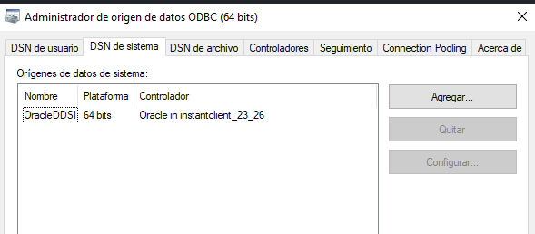

### setupDB.php / conexion.php

Este archivo se encarga de preparar y reiniciar nuestra base de datos Oracle. 

Para ello, utiliza la conexión definida en Conexion.php, elimina las tablas existentes, las vuelve a crear e introduce unos datos iniciales para realizar pruebas. En PHP tenemos varias formas de conectarnos, hemos utilizado PDO mediante el controlador ODBC para conectarnos a Oracle

La conexión en php se suele crear como un objeto, en el que tenemos los métodos obtenerConexion() y cerrarConexion().

```php

public function __construct(){
        // DSN ODBC configurado previamente en el equipo.
        $host = "oracle0.ugr.es";
        $puerto = "1521";
        $servicio = "practbd";
        $usuario = "x5123750";
        $password = "x5123750";
        // $dsn = "oci:dbname=//$host:$puerto/$servicio";

        $dsn = "odbc:OracleDDSI";

        $this->conexion = new PDO($dsn, $usuario, $password, [
            PDO::ATTR_ERRMODE => PDO::ERRMODE_EXCEPTION
        ]);
    }

```

Una vez ya en setup.php, iniciamos la conexión importando el archivo de conexion.php y creando un objeto y usando sus métodos. Además este archivo solo permite peticiones POST desde el Frontend. Para borrar los datos creamos un array con el orden de borrado por si acaso, creamos la consulta y hacemos la solicitud.


Además añadimos un trigger para cuando se elimine algo de un pedido, el stock vuelva a su sitio automáticamente.

```php

require_once __DIR__ . "/Conexion.php";

$conexion = new Conexion();
$db = $conexion->obtenerConexion();


// ==================================

foreach ($ordenBorrado as $nombre) {

    $stmt = $db->prepare(
        "SELECT COUNT(*) FROM user_tables
            WHERE table_name = ?"
    );

    $stmt->execute([$nombre]);

    if ((int) $stmt->fetchColumn() > 0) {
        $db->exec("DROP TABLE $nombre");

        // echo "Tabla $nombre eliminada.\n";
    }
}

$db->exec("
    CREATE OR REPLACE TRIGGER trg_detalle_restaurar_stock
    AFTER DELETE ON Detalle_Pedido
    FOR EACH ROW
    BEGIN
        UPDATE Stock
        SET Cantidad = Cantidad + :OLD.Cantidad
        WHERE Cproducto = :OLD.Cproducto;
    END;
");

```

Después volvemos a crear la estructura de la BBDD en un array con la estructura y varias variables con sus datos por defecto y hacemos lo mismo, ejecutamos la consulta y ya tendríamos creada nuestra BD por defecto.

Finalmente cerramos la conexion con la base de datos, y enviamos los datos que necesitemos para la web al Frontend.


```php

    foreach ($tablas as $nombre => $sql) {
        $db->exec($sql);

        // echo "Tabla $nombre creada.\n";
    }

    /* ======================== */

    $stmt = $db->prepare(
        "INSERT INTO Stock (Cproducto, Nombre, Cantidad) VALUES (?, ?, ?)"
    );

    foreach ($productos as $producto) {
        $stmt->execute($producto);
    }

    foreach ($clientes as $cliente) {
        $stmt->execute($cliente);
    }

    $db->exec("COMMIT");
```


### Producto.php

Este archivo contiene la clase Producto, encargada de realizar las operaciones sobre la tabla Stock de nuestra base de datos: consultar, insertar, modificar y eliminar productos.

En este archivo tenemos varias funciones, las  cuales la mayoria constan con una consulta a la base de datos

Normalmente cuando realizamos una consulta a la BBDD, la metemos en una variable/objeto, la preparamos y la ejecutamos, el lenguaje manda la consulta y la BBDD devuelve ciertas cosas dependiendo de lo realizado, pues estos datos también los podemos recoger ( depende del servicio nos lo devuelve en un formato u otro ), en nuestro caso en PHP con fetch()/fetchAll()/rowCount() entre otros, además este objeto devuelto tiene sus propias funciones con las que obtenemos información.

`obtenerProductos()` -> Esta funcion nos devuelve directamente todos los productos como una matriz. \
`obtenerProducto(int $codigo)` -> Esta igual que la anterior, pero busca por código. \
`existeProducto(int $codigo)` -> Función de comprobación, básicamente esta de apoyo para evitar errores. \
`comprobarStock(int $codigo, int $cantidad)` -> Igual que la anterior, de apoyo. 

Estas funciones ya si necesitan más parametros, que reciben de JS, y crean la consulta en base a estos parametros. \
`insertarProducto( ... )` -> Le llegan los datos de creacion (id,Stock,Nombre)
`actualizarStock( ... )` -> Permite modificar únicamente la cantidad de un producto. Es una función auxiliar disponible, aunque actualmente el control del stock de los pedidos se realiza desde detallesPedido.php
`actualizarProducto( ... )` -> Esta de aqui se usa para actualizar un producto manualmente.
`eliminarProducto(int $codigo)` -> Se mete su id, y simplemente hace un DELETE de la fila correspondiente.

```php

public function obtenerProductos(): array{
        $sql = "SELECT Cproducto, Nombre, Cantidad
                FROM Stock ORDER BY Cproducto";

        $stmt = $this->db->query($sql);

        return $stmt->fetchAll(PDO::FETCH_ASSOC);
    }


public function actualizarProducto( int $codigo, string $nombre, int $cantidad ): bool {

        if ($codigo <= 0 ||
            trim($nombre) === "" ||
            mb_strlen($nombre) > 50 ||
            $cantidad < 0) {

            throw new InvalidArgumentException(
                "Datos del producto no válidos"
            );
        }

        $sql = "UPDATE Stock
                SET Nombre = ?, Cantidad = ?
                WHERE Cproducto = ?";

        $stmt = $this->db->prepare($sql);
        $stmt->execute([
            trim($nombre),
            $cantidad,
            $codigo
        ]);

        return $stmt->rowCount() > 0;
    }

    public function eliminarProducto(int $codigo): bool{
        if ($codigo <= 0) {
            throw new InvalidArgumentException(
                "Código no válido"
            );
        }

        $sql = "DELETE FROM Stock
                WHERE Cproducto = ?";

        $stmt = $this->db->prepare($sql);
        $stmt->execute([$codigo]);

        return $stmt->rowCount() > 0;
    }

```


### Cliente.php

Este archivo contiene la clase Clientes, encargada de gestionar los registros de la tabla Clientes de Oracle, permitiendo consultar, insertar, modificar y eliminar clientes.

Realmente no tiene mucho misterio frente al archivo anterior, las clases funcionan casi igual, dependiendo de la funcionalidad se crea una consulta, se prepara, se ejecuta y si es necesario recogemos el resultado en el formato conveniente, a partir de aqui entraremos menos en detalle en los códigos hasta los puntos importantes.

`obtenerClientes()` \
`obtenerCliente(int $codigo)` \
`existeCliente(int $codigo)` \
`insertarCliente(int $codigo, string $nombre)` \
`actualizarCliente(int $codigo, string $nombre)` \
`eliminarCliente(int $codigo)` 

```php

public function obtenerClientes(): array{
    $sql = "SELECT ID_Cliente, Nombre
            FROM Clientes ORDER BY ID_Cliente";

    return $this->db->query($sql)->fetchAll(PDO::FETCH_ASSOC);
}

public function eliminarCliente(int $codigo): bool{
    if ($codigo <= 0) {
        throw new InvalidArgumentException(
            "Código no válido"
        );
    }

    $sql = "DELETE FROM Clientes WHERE ID_Cliente = ?";

    $stmt = $this->db->prepare($sql);
    $stmt->execute([$codigo]);

    return $stmt->rowCount() > 0;
}

```


### pedido.php y detallePedido.php

En estos códigos están las funcionalidades de crear un pedido y añadirle sus detalles en otro apartado como los tipos de productos añadidos al pedido.

Pedido: almacena la información general del pedido (código, cliente y fecha).
Detalle_Pedido: almacena los productos y las cantidades asociadas a cada pedido.

- 1.Pedidos

Esta clase contiene los métodos necesarios para consultar, crear, modificar y eliminar pedidos mediante las correspondientes operaciones SQL.

A diferencia de las clases anteriores, debemos tener en cuenta que un pedido puede contener varios productos, los cuales se almacenan por separado en Detalle_Pedido.

La fecha se valida en formato YYYY-MM-DD y se convierte a un valor de tipo DATE de Oracle al guardar el pedido.

`obtenerPedidos()` \
`crearPedido(int $codigo, int $cliente, string $fecha)` \
`actualizarPedido(int $codigo, int $cliente, string $fecha)` \
`eliminarPedido(int $codigo)` 

- 2.Detalle Pedido

Esta clase tiene una funcionalidad más importante, ya que además de gestionar los detalles debe controlar las existencias de los productos.

Cuando añadimos un producto a un pedido, primero comprobamos que exista, que no esté repetido en ese pedido y que haya suficientes unidades disponibles, por eso usaremos métodos de otras clases, para apoyarnos.

También usamos la cláusula `FOR UPDATE`, que bloquea el dato para que otra transacción no lo modifique a la vez. Y si hay stock y todo es correcto lo descontamos y añadimos al detalle.

```php

$sql = "SELECT Cantidad FROM Stock
        WHERE Cproducto = ? FOR UPDATE";

$stmt = $this->db->prepare($sql);
$stmt->execute([$codigoProducto]);


$sql = "UPDATE Stock
        SET Cantidad = Cantidad - ?
        WHERE Cproducto = ?";

$stmt = $this->db->prepare($sql);
$stmt->execute([$cantidad, $codigoProducto]);

```

`obtenerDetalles() ` \
`obtenerDetallesPedido(int $codigoPedido) ` \
`obtenerDetalle(int $codigoPedido, int $codigoProducto) ` \
`existeDetalle(int $codigoPedido, int $codigoProducto) ` \
`insertarDetalle(int $codigoPedido, int $codigoProducto, int $cantidad) ` \
`actualizarDetalle(int $codigoPedido, int $codigoProducto, int $nuevaCantidad) ` \
`eliminarDetalle(int $codigoPedido, int $codigoProducto) ` \
`eliminarDetallesPedido(int $codigoPedido) ` 

Por último, cuando eliminamos un detalle, únicamente ejecutamos el DELETE correspondiente. El `trigger de Oracle`, que definimos anteriormente en setupBD.php, se encarga de devolver automáticamente esas unidades al stock.


### /API/ - FILAS | PEDIDOS | TABLAS

Aqui empezamos con los archivos de la carpeta API, ya que mucha de la funcionalidad de estos es de apoyo para JS, para que el Frontend recupere ciertos datos para las tablas, o al modificar filas sin necesidad de recargar la página.

Pero lo interesante está en api/pedidos.php, el cuál es el archivo que se encarga de la lógica y el funcionamiento de las transacciones, además de conectar con JS y permitir ver el proceso de la transacción en pantalla.

`api/tablas.php` y `/api/filas.php`

Por ejemplo estos archivos hacen de intermediario en lo comentado anteriormente.

`tablas.php` permite a JS realizar una petición GET mediante fetch() y recuperar datos actualizados. Y de cara a la BBDD usa los métodos creados en las clases anteriores para la funcionalidad.


`filas.php` a diferencia del anterior recibe una petición POST con información en formato JSON, utiliza un switch para la tabla correspondiente y llamara al método correcto.

Aqui si que usamos una pequeña transacción, funciona para cualquier cambio, pero el ejemplo más adecuado es cuando cambiamos detallePedido y justo después se cambia el stock, funcionan como dos consultas que deben de ser correctas ambas. 

```php

$datos = json_decode(
    file_get_contents('php://input'),
    true,
    512,
    JSON_THROW_ON_ERROR
);

$tabla = $datos['tabla'] ?? '';
$accion = $datos['accion'] ?? '';
$fila = $datos['fila'] ?? null;
$clave = $datos['clave'] ?? null;

...

$db->beginTransaction();

...

$exito = $detalles->actualizarDetalle(
    entero($clave[0] ?? null, 'Cpedido'),
    entero($clave[1] ?? null, 'Cproducto'),
    entero($fila[2] ?? null, 'Cantidad')
);

/* en el try{}  por si funciona correctamente */
$db->commit();

/* en el }cathc{}  por si falla la transacción. */
if ($db instanceof PDO && $db->inTransaction()) {
    $db->rollBack();
}

```


Y finalmente tenemos `api/pedidos.php`, aqui ya usamos Transacciones completas entre pedidos y detallePedidos usando commit, savepoint y rollback.

La idea principal es poder iniciar un pedido, e ir añadiendo productos, y quitandolos si es necesario creando savepoints y haciendo rollback e incluso una limpieza completa, una vez tenemos todo terminado hacemos el commit y listo.

Como antes recibimos la información desde JS mediante POST (formato JSON), lo formateamos con json_decode() y los usamos más adelante

Después iniciamos la transacción e insertamos la cabecera del pedido creando el SAVEPOINT inicial:

```php

$db->beginTransaction();

$pedidos->crearPedido($codigo, $cliente, $fecha);

$db->exec('SAVEPOINT inicio_detalles');

```

Lo siguiente es declarar ciertas variables de control, y dentro de un bucle con switch creamos los Savepoints o hacemos los Rollbacks dependiendo de lo que hagamos.

```php

/* Creacion de Savepoint */
$db->exec("SAVEPOINT $nombreSavepoint");

/* Rollback de 1 detalle/producto del pedido */
$db->exec("ROLLBACK TO SAVEPOINT $destino");

/* Rollback a inicio ya sea por Limpiar o Cancelar la acción respectivamente. */
$db->exec('ROLLBACK TO SAVEPOINT inicio_detalles');
$db->rollBack();

/* Para finalizar si ya esta todo correcto. */
$db->commit();
```

Esto último en caso de que todo este correcto, tenemos en cuenta que este codigo está dentro de un try/catch, pues en caso del catch tenemos un rollback más al inicio.

```php

if ($db instanceof PDO && $db->inTransaction()) {
    try {
        $db->rollBack();
    } catch (Throwable $ignorado) {
    }
}

```

### FOTOS WEB

Para terminar esta documentación de la práctica vamos a dejar algunas imágenes de la web.

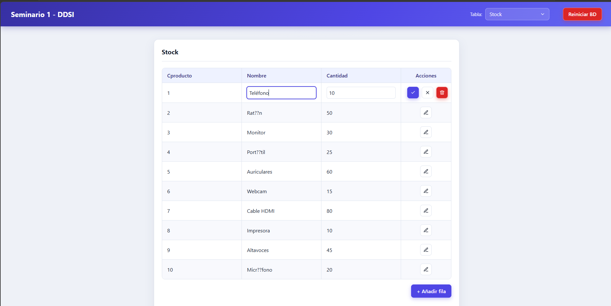
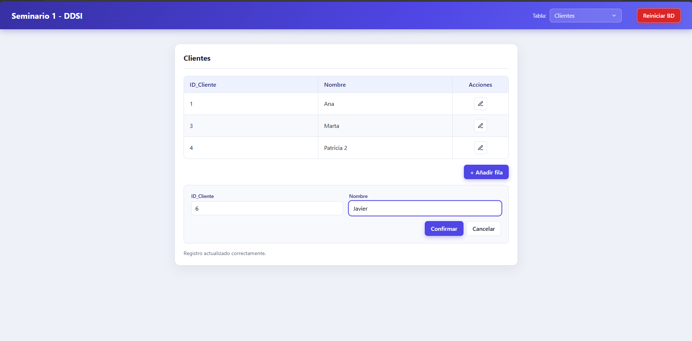
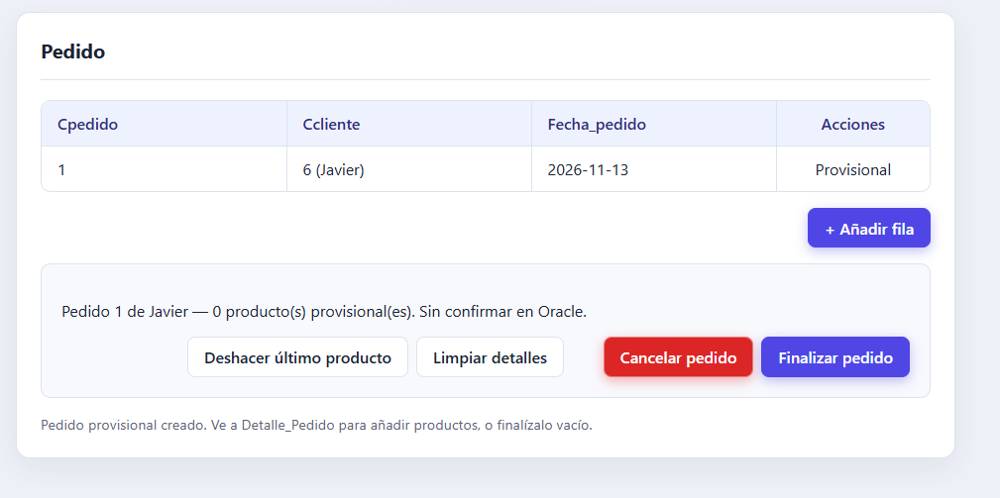
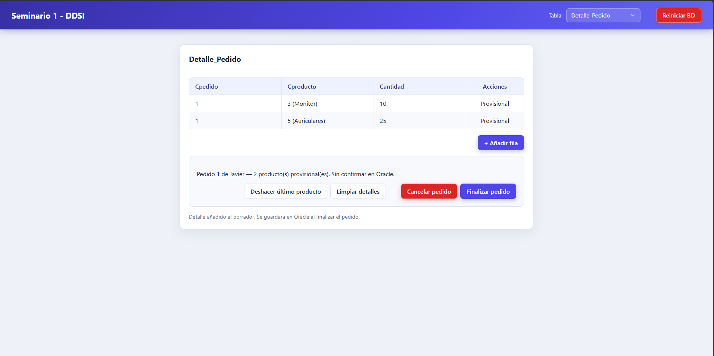
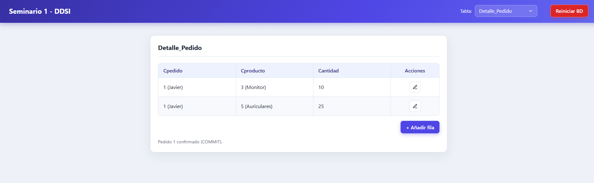
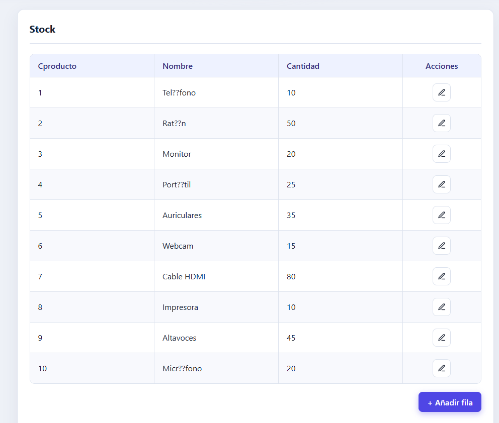
