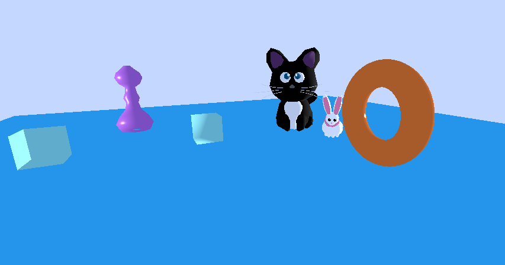
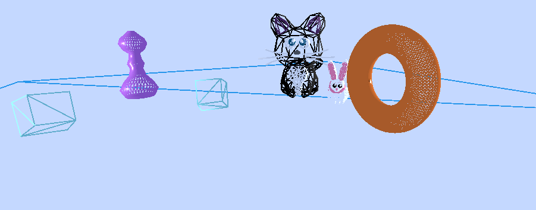
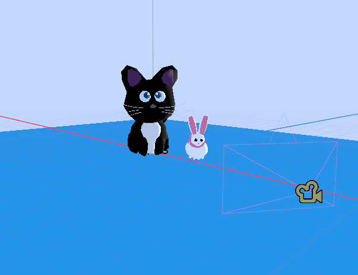
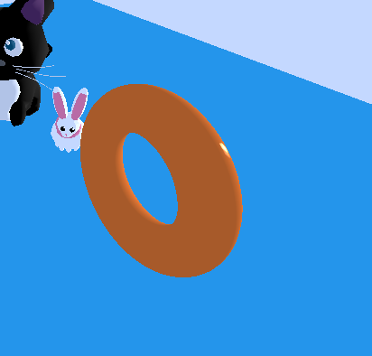
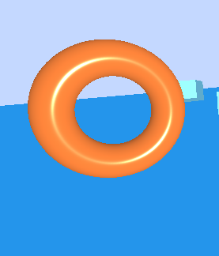
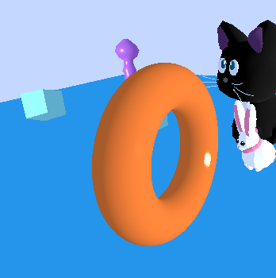
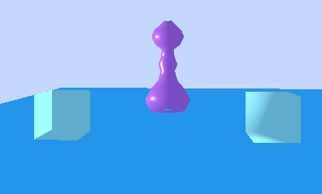
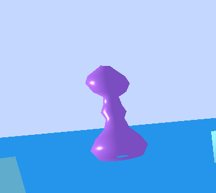

## **PRACTICA 2 | IG**

En esta práctica se ha trabajado con la representación y generación de mallas 3D en Godot, partiendo de los conceptos básicos vistos en la práctica anterior. Se han cargado modelos externos en formatos GLB y OBJ, se ha añadido un modo de visualización wireframe y se ha estudiado el papel de las normales en la iluminación de los objetos.

También se han comparado distintos tipos de sombreado, se han analizado las diferencias entre mallas suaves y objetos con aristas reales, y se han generado objetos de forma procedural mediante código. Finalmente, se ha implementado un algoritmo de revolución de un perfil 2D alrededor del eje Y para construir una malla tridimensional y calcular sus normales.


Finalmente, como aporte personal, hemos puesto una plataforma en la que se apoyan todos los objetos generados, para no tenerlos flotando, y hemos cambiado el fondo un Objeto WorldEnvironment para no tener un fondo gris algo desagradable.


- ( Los códigos dados por el profesor no los pondrémos en cada apartado )


### **Modo de visualización Wireframe**

Se añadió al nodo raíz de la escena el script script_raiz.gd, cuya función es permitir cambiar entre la visualización normal y el modo wireframe pulsando la tecla W.

El modo wireframe muestra únicamente las aristas de los triángulos que forman las mallas 3D. Esto resulta especialmente útil para analizar cómo están construidos los objetos y comprobar la distribución de sus triángulos durante la generación de geometría.

Al pulsar la tecla W, se alterna entre ambos estados y se cambia el modo de dibujo del Viewport.





### **Carga de modelos 3D externos**

Durante la práctica se importaron modelos externos en formatos GLB y OBJ para comprobar cómo trabaja Godot con distintos tipos de archivos 3D, y se han guardado dentro de la carpeta modelos3D y se han añadido como hijos de ObjetosP2 ( en godot ).

En la práctica se importaron modelos en formatos GLB y OBJ. El formato GLB permite incluir geometría, materiales y texturas en un único archivo, mientras que el formato OBJ suele necesitar también un archivo .mtl para definir sus materiales.




### **Donut y cálculo de normales**

Se creó un objeto con forma de donut mediante una malla generada por código. 
Para ello se utilizan arrays de vértices y triángulos, a partir de los cuales se construye la geometría del objeto.

Después se calculan las normales de cada vértice mediante calcNormales(). 
Estas normales se obtienen a partir de las caras adyacentes y son necesarias para que la iluminación del objeto se calcule correctamente.

Finalmente, con los vértices, triángulos y normales se crea una ArrayMesh y se aplica un material al donut.




### **Sombreado por píxel y por vértice**

Se compararon los dos tipos de sombreado disponibles en Godot utilizando el donut.

  

Con el sombreado por píxel (```BaseMaterial3D.SHADING_MODE_PER_PIXEL```), la iluminación se calcula en cada píxel de la superficie, obteniendo un resultado más suave y realista. 




En cambio, con el sombreado por vértice (```BaseMaterial3D.SHADING_MODE_PER_VERTEX```), la iluminación se calcula en los vértices y después se interpola sobre los triángulos, por lo que el resultado es menos preciso.




### **Cubo de 8 y 24 vértices**

Se crearon dos cubos para comprobar cómo afecta la organización de los vértices al cálculo de las normales.

El primer cubo utiliza 8 vértices, compartiendo cada vértice entre varias caras. Al calcular las normales como promedio de las caras adyacentes, estas apuntan en direcciones diagonales y la iluminación hace que el cubo parezca más suavizado de lo esperado.

```gdscript

var vertices := PackedVector3Array([
		Vector3(-0.5, -0.5, -0.5), # 0
		Vector3( 0.5, -0.5, -0.5), # 1
		Vector3( 0.5,  0.5, -0.5), # 2
		Vector3(-0.5,  0.5, -0.5), # 3
		Vector3(-0.5, -0.5,  0.5), # 4
		Vector3( 0.5, -0.5,  0.5), # 5
		Vector3( 0.5,  0.5,  0.5), # 6
		Vector3(-0.5,  0.5,  0.5)  # 7
	])

	var triangulos := PackedInt32Array([
		0, 2, 1,  0, 3, 2,
		1, 6, 5,  1, 2, 6,
		5, 7, 4,  5, 6, 7,
		4, 3, 0,  4, 7, 3,
		3, 6, 2,  3, 7, 6,
		4, 1, 5,  4, 0, 1
	])

	var normales := Utilidades.calcNormales(vertices, triangulos)

```

El segundo cubo utiliza 24 vértices, repitiendo los vértices de cada esquina para que cada cara tenga sus propios vértices y normales. De esta forma, las normales quedan perpendiculares a cada cara y las aristas se representan correctamente como aristas duras.


```gdscript

	var vertices := PackedVector3Array([
		# Cara frontal
		Vector3(-0.5, -0.5,  0.5),
		Vector3( 0.5, -0.5,  0.5),
		Vector3( 0.5,  0.5,  0.5),
		Vector3(-0.5,  0.5,  0.5),

		# Cara trasera
		Vector3( 0.5, -0.5, -0.5),
		Vector3(-0.5, -0.5, -0.5),
		Vector3(-0.5,  0.5, -0.5),
		Vector3( 0.5,  0.5, -0.5),

		# Cara izquierda
		Vector3(-0.5, -0.5, -0.5),
		Vector3(-0.5, -0.5,  0.5),
		Vector3(-0.5,  0.5,  0.5),
		Vector3(-0.5,  0.5, -0.5),

		# Cara derecha
		Vector3( 0.5, -0.5,  0.5),
		Vector3( 0.5, -0.5, -0.5),
		Vector3( 0.5,  0.5, -0.5),
		Vector3( 0.5,  0.5,  0.5),

		# Cara superior
		Vector3(-0.5,  0.5,  0.5),
		Vector3( 0.5,  0.5,  0.5),
		Vector3( 0.5,  0.5, -0.5),
		Vector3(-0.5,  0.5, -0.5),

		# Cara inferior
		Vector3(-0.5, -0.5, -0.5),
		Vector3( 0.5, -0.5, -0.5),
		Vector3( 0.5, -0.5,  0.5),
		Vector3(-0.5, -0.5,  0.5)
	])

	var triangulos := PackedInt32Array([
		0, 1, 2,   0, 2, 3,
		4, 5, 6,   4, 6, 7,
		8, 9, 10,  8, 10, 11,
		12, 13, 14, 12, 14, 15,
		16, 17, 18, 16, 18, 19,
		20, 21, 22, 20, 22, 23
	])

	var normales := Utilidades.calcNormales(vertices, triangulos)

```




### **Generación de una malla por revolución**

Un objeto revolucion es un objeto 3D, hecho a partir de una base 2D y generada por el giro de un eje, en nuestro caso hemos girado en base al eje Y.

Para generar nuestro objeto se definió primero un perfil 2D mediante varios puntos Vector2. Después se fueron creando copias de ese perfil alrededor del eje Y y se unieron los vértices generados mediante triángulos para formar la superficie 3D.

Finalmente, se calcularon las normales de la malla y se creó la ArrayMesh del objeto.

```gdscript

extends Node

	func generar_revolucion(
		perfil: PackedVector2Array,
		num_copias: int,
		vertices: PackedVector3Array,
		triangulos: PackedInt32Array
	) -> void:

	var n_perfil := perfil.size()

	# Generar las copias rotadas del perfil
	for i in num_copias:
		var angulo := 2.0 * PI * float(i) / float(num_copias)

		var cos_a := cos(angulo)
		var sin_a := sin(angulo)

		for p in perfil:
			var x := p.x
			var y := p.y

			vertices.append(
				Vector3(
					x * cos_a,
					y,
					x * sin_a
				)
			)

	# Unir cada copia del perfil con la siguiente mediante triángulos
	for i in num_copias:
		var sig := (i + 1) % num_copias

		for j in range(n_perfil - 1):
			var a := i * n_perfil + j
			var b := sig * n_perfil + j
			var c := sig * n_perfil + j + 1
			var d := i * n_perfil + j + 1

			triangulos.append(a)
			triangulos.append(c)
			triangulos.append(b)

			triangulos.append(a)
			triangulos.append(d)
			triangulos.append(c)


```

